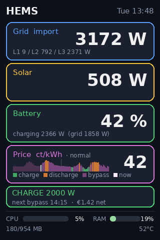

# pi-hems

A lightweight Home Energy Management System on a Raspberry Pi 3B+.

First goal: optimise charging and discharging of a **Zendure SolarFlow 2400 Pro**
(PV + home battery) using local device data and **Tibber** dynamic prices.

<p align="center"></p>

<p align="center"><sub>Status screen (3.5" TFT, portrait): energy flow between solar, grid, battery and home; weather; 15-min prices for today + tomorrow coloured by the plan; current plan step; CPU/RAM/disk.</sub></p>

## Hardware

| Part | Notes |
|---|---|
| Raspberry Pi 3 Model B+ | DietPi 64-bit (Debian 13 Trixie), Ethernet only, 16 GB microSD |
| 3.5" SPI TFT (ILI9486) | 480x320, `piscreen` overlay, used in portrait as a status display (touch not used) |
| Zendure SolarFlow 2400 Pro | + 2 extra battery packs, local zenSDK HTTP API |
| Zendure Smart Meter P1 | reads the DSMR P1 port, local HTTP API, 3-phase |
| Tibber | dynamic price contract, 15-minute prices via GraphQL API |

## Architecture

```
Zendure P1 meter ──(LAN)──┐
                          ├──► Pi ──► 3.5" TFT status screen
SolarFlow 2400 Pro ─(LAN)─┘    │
                               ├──► energy log (15-min CSV)
Tibber API (prices) ──────────►┘
```

All device communication is local (`GET /properties/report`,
`POST /properties/write`). Writes always set `smartMode=1` so the device
does not write them to flash. `EXECUTOR_DRY_RUN` in `config.py` decides
whether commands are actually sent.

## Planner

Each 15-minute slot gets one mode:

| Mode | Battery |
|---|---|
| CHARGE | charge from the grid |
| BYPASS | hold; house runs on grid (solar may still charge) |
| DISCHARGE | self-use, cover house load, never export |

A charge/discharge pair is only worth it when

```
discharge price > charge price / (eta_charge * eta_discharge) + wear
```

The planner solves this over the whole known price horizon (up to ~44 h after
13:00) as a linear program and re-plans every slot with the measured SOC.

## Components (`hems/`)

| File | Purpose |
|---|---|
| `devices.py` | Read P1 meter and SolarFlow over the local API |
| `tibber.py` | Fetch Tibber 15-min prices, cache in `/var/lib/hems/prices.json`, background refresh |
| `display.py` | Status screen: 2x2 Solar/Grid/Battery/Home tiles with energy-flow arrows, weather, price chart (today + tomorrow, coloured by plan), plan, CPU/RAM/disk; dims between sunset and sunrise |
| `weather.py` | Current temperature + weather code from Open-Meteo (no key), every 15 min |
| `logger.py` | Samples every 5 s, writes 15-min energy totals split by operating mode to `/var/lib/hems/energy-YYYY-MM.csv` |
| `config.py` | All tunables: device IPs, battery capacity/limits, efficiencies, wear cost, shadow mode |
| `planner.py` | Linear-program battery plan over all known 15-min prices: CHARGE / BYPASS / DISCHARGE per slot; `hems-plan` prints it |
| `guard.py` | Fuse guard: limits grid charging to the spare capacity on the battery's phase (L3, 22 A of 25 A); no P1 data = no grid charging |
| `executor.py` | Turns the current plan slot into SolarFlow commands (`acMode`, `inputLimit`, `outputLimit`, always `smartMode=1`); zero-export load follower while discharging; dry-run by default |
| `web.py` + `web/index.html` | Read-only web page on port 80 (`http://hems.local/`): energy flow, prices + plan, executor, system; JSON at `/api/state` |
| `report.py` | `hems-report [YYYY-MM-DD]`: measured charge/discharge efficiency, round trip, standby drain |

## Setup

1. Flash DietPi (RPi 2/3/4 ARMv8 image), headless, Ethernet, SSH key.
2. Append `boot/config.txt.snippet` to `/boot/firmware/config.txt`, reboot.
3. `apt install python3 python3-pil python3-numpy python3-scipy fonts-dejavu-core avahi-daemon`
   (avahi makes the Pi reachable as `hems.local`)
4. Enable the Zendure local API in the Zendure app (add HEMS).
5. Store the Tibber token on the Pi (root-only, never in git):
   ```bash
   ssh -t root@<pi> 'read -rsp "Tibber token: " t; echo; umask 077; mkdir -p /etc/hems; printf "TIBBER_TOKEN=%s\n" "$t" > /etc/hems/secrets.env'
   ```
6. Set the device IPs in `hems/config.py` as a starting point (they are rediscovered
   automatically if they change), then `./deploy.sh root@<pi>`.
7. Change the default root password (`passwd`), then allow SSH keys only: copy
   `ssh/00-hems-keyonly.conf` to `/etc/ssh/sshd_config.d/` and `systemctl reload ssh`.
   Check that key login works first; `deploy.sh` does not do this step.

## Status

- [x] OS, display, live data, Tibber prices
- [x] Energy logger to measure real losses
- [x] Planner v1 (LP, shadow mode): plan + decision log, shown on the TFT
- [ ] Measured efficiencies and confirmed battery capacity / wear cost
- [x] Executor (dry-run): commands logged, not sent
- [x] P1 export sign verified (export = negative `total_power`)
- [x] Live since 2026-11-24 13:34 (Zendure app: custom mode, all schedules deleted)
- [ ] Load forecast instead of fixed house load

## Findings

- **Zendure app modes overwrite local commands.** In the app's self-consumption
  mode the device's own loop writes `acMode`/`outputLimit` (with `smartMode=1`)
  and overrides local BYPASS within ~12 s and CHARGE within ~22 s. A hybrid
  (app self-consumption + local charge/hold) is not possible; the app must be
  in a mode that does not control the battery. **Custom mode with all
  schedules deleted works**: local commands hold. (Test 2026-11-24, `tools/zcheck.py`.)
- The TFT backlight is wired permanently on (GPIO22 has no effect), so
  night mode can only dim the image, not switch the backlight off. HDMI
  output is switched off at boot (`hems-hdmi-off`).
- Device IPs can change on DHCP renewal (the P1 meter moved overnight).
  `devices.py` rescans the /24 after 3 failed reads and shares the new
  address via `/run/hems/addresses.json`. DHCP reservations are still advised.
- Native self-consumption reacts to load steps in 10-20 s and keeps the grid
  within about +-15 W in steady state.
